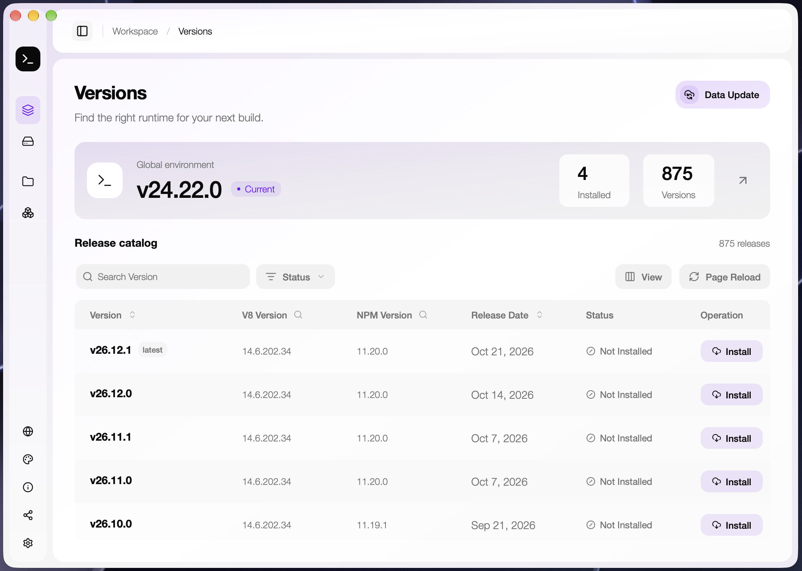
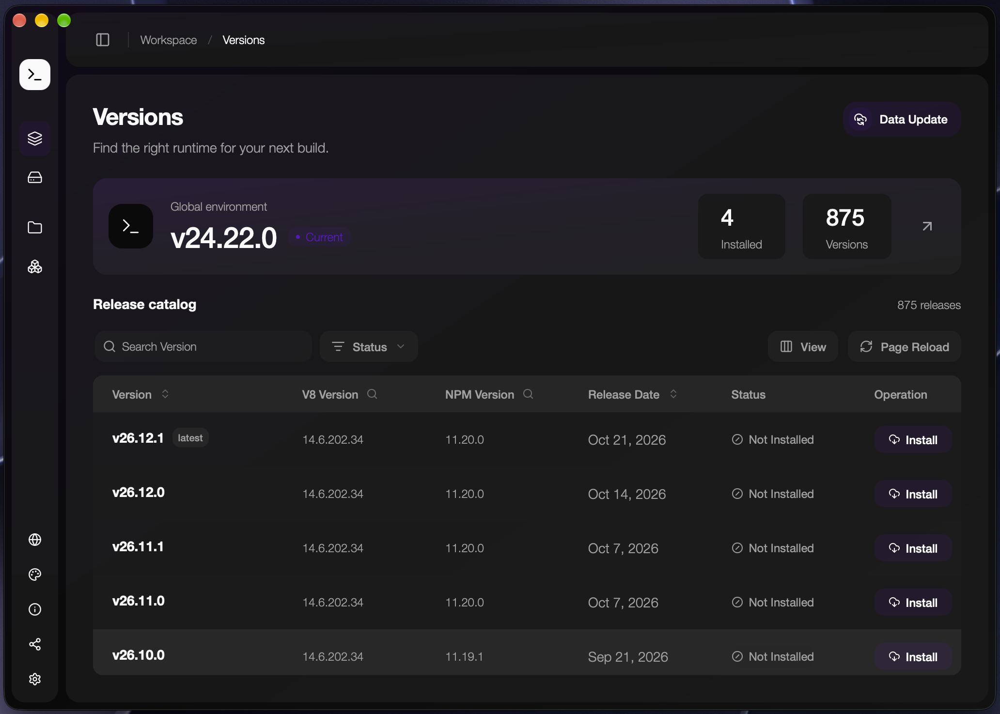
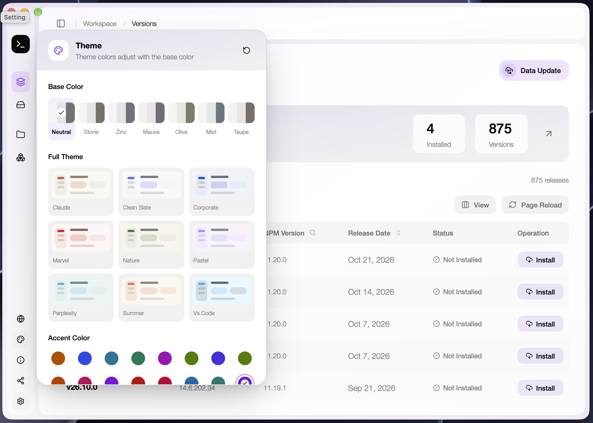
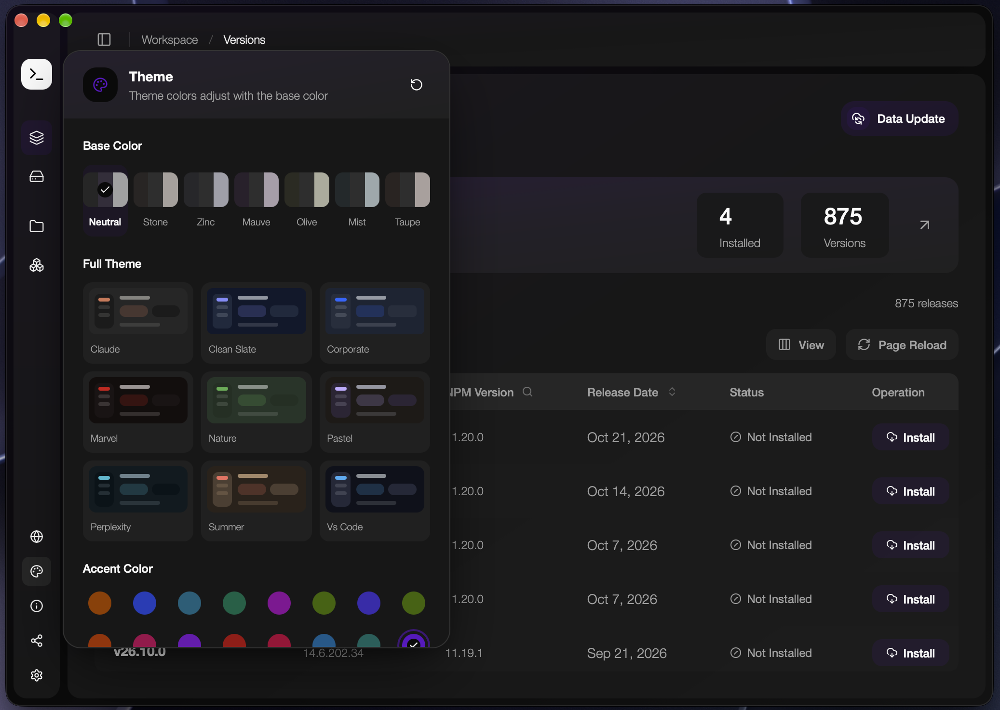
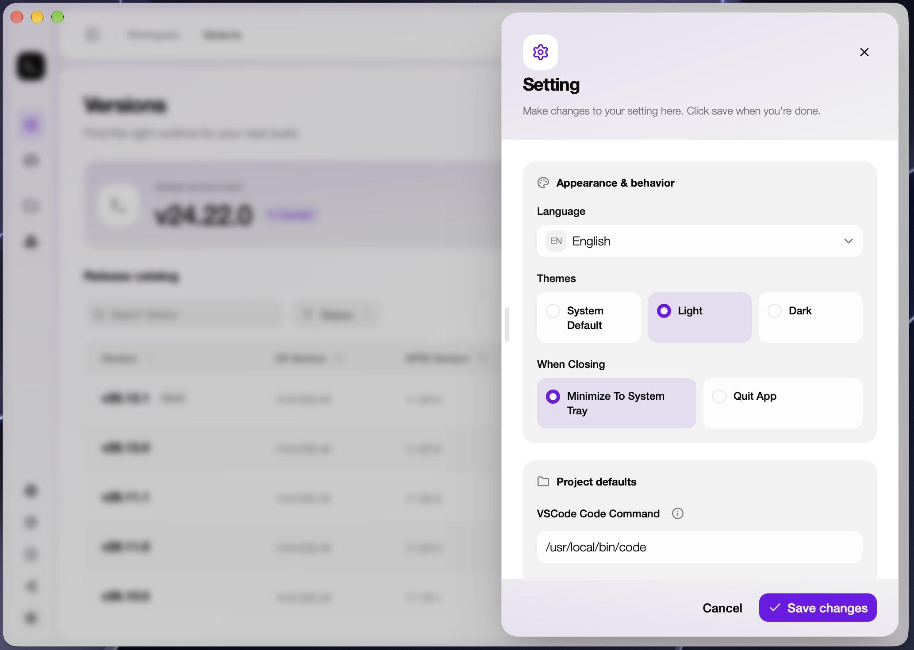
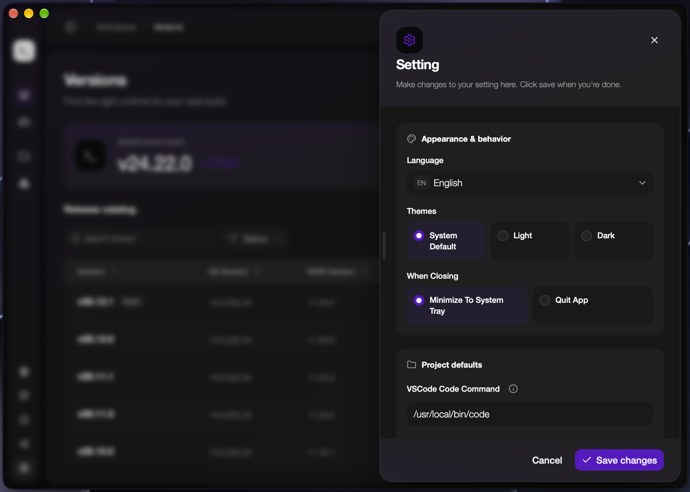

<div align="center">
  

  <h1>NVM Desktop</h1>
  <p><strong>让每个项目，都用上合适的 Node.js。</strong></p>
  <p>通过桌面应用和命令行，在 macOS、Windows 和 Linux 上管理 Node.js 版本。</p>

  <p>
    <a href="https://github.com/1111mp/nvm-desktop/releases">下载应用</a> ·
    <a href="#快速开始">快速开始</a> ·
    <a href="#命令行">命令行</a> ·
    <a href="https://github.com/1111mp/nvm-desktop/issues">反馈问题</a>
  </p>
  <p><a href="./README.md">English</a> · 简体中文</p>
</div>

## 多个 Node.js 版本，一个工作空间

维护旧服务、开发新应用，或同时处理多个相关仓库时，不必让所有项目共用同一个运行时。NVM Desktop 支持安装多个版本、设置全局默认版本、为单个项目指定版本，以及按分组统一管理项目环境。

用 **NVM Desktop** 浏览和整理环境，用 **`nvmd`** 在终端中执行命令和编写脚本。

| 能力       | 可以做什么                                                         |
| ---------- | ------------------------------------------------------------------ |
| 版本管理   | 浏览发行版本，选择架构，安装和卸载 Node.js。                       |
| 项目环境   | 为项目文件夹指定版本，无需改变全局默认版本。                       |
| 项目分组   | 让相关项目共用一个版本，在一处统一切换。                           |
| GUI 与 CLI | 根据工作习惯，在图形界面或终端中管理版本。                         |
| 外观定制   | 支持浅色、深色和跟随系统，以及基础色、强调色、完整主题和圆角调整。 |
| 配置管理   | 自定义镜像源、代理、项目默认设置，并导入或导出配置。               |

## 应用截图

**Node.js 版本管理**

<p align="center">
  
  
</p>

**主题定制**

<p align="center">
  
  
</p>

**应用设置**

<p align="center">
  
  
</p>

## 快速开始

### 1. 安装桌面应用

前往 [GitHub Releases](https://github.com/1111mp/nvm-desktop/releases)，下载适合操作系统和架构的安装包。安装并启动 NVM Desktop，首次引导会介绍终端配置和版本安装流程。

### 2. 配置终端环境

**macOS 和 Linux** — 将以下内容添加到 Shell 启动文件中，例如 Zsh 的 `~/.zshrc` 或 Bash 的 `~/.bashrc`：

```shell
export NVMD_DIR="$HOME/.nvmd"
export PATH="$NVMD_DIR/bin:$PATH"
```

保存后重新打开终端。

**Windows** — 确认用户 `PATH` 中包含以下目录，再重新打开终端：

```text
%USERPROFILE%\.nvmd\bin
```

确认命令行工具可用：

```shell
nvmd --version
```

### 3. 安装并选择 Node.js

在**版本列表**中选择版本和架构并安装，然后到**已安装**页面将某个版本设为全局默认版本。

也可以使用终端。以下版本号仅作示例，请替换成你需要的版本：

```shell
nvmd install 20.18.0
nvmd use 20.18.0
node --version
npm --version
```

## 日常工作流

### 查找和管理运行时

在**版本列表**中浏览和筛选可安装的发行版本，在**已安装**中查看本地运行时、切换全局默认版本，或移除不再需要的版本。安装时，应用会显示下载和解压状态。

### 为每个项目指定版本

1. 打开**项目**页面，添加项目文件夹。
2. 为项目选择一个已安装的 Node.js 版本。
3. 在项目目录中打开终端，运行 `node --version` 确认版本。

应用会把项目版本写入版本文件。默认文件名为 `.nvmdrc`，也可以在**设置**中改为 `.nvmrc`、`.node-version` 等名称。当前目录中配置的版本文件优先于全局默认版本。

在项目目录中，也可以通过命令指定版本：

```shell
nvmd use 20.18.0 --project
```

### 统一管理相关项目

在**分组**页面创建分组、选择 Node.js 版本，并关联需要统一管理的项目。修改分组版本会更新其关联项目。每个项目最多属于一个分组。

项目文件夹需要存在且可写，以便应用更新其中的版本文件。

## 命令行

应用附带的 **`nvmd`** 工具可以配合桌面应用，完成终端中的版本管理工作。

| 操作             | 命令                                  |
| ---------------- | ------------------------------------- |
| 安装版本         | `nvmd install 20.18.0`                |
| 查看已安装版本   | `nvmd list`                           |
| 设置全局默认版本 | `nvmd use 20.18.0`                    |
| 设置当前项目版本 | `nvmd use 20.18.0 --project`          |
| 查看当前版本     | `nvmd current`                        |
| 卸载版本         | `nvmd uninstall 20.18.0`              |
| 查找可执行文件   | `nvmd which node` 或 `nvmd which npm` |
| 查看命令帮助     | `nvmd --help`                         |

在终端中切换版本后，可以刷新应用的相关页面以更新显示信息。CLI 在独立仓库 [nvmd-command](https://github.com/1111mp/nvmd-command) 中维护。

## 按习惯配置应用

侧栏底部提供外观、Tip、配置管理、设置和应用更新入口。

**外观。** 可以单独使用 Base Color，也可以增加 Accent Color，或选择 Full Theme。强调色与完整主题是两种替代方案。主题定制支持调整圆角；在设置中可以选择浅色、深色或跟随系统。

**设置。** 可以配置语言、关闭窗口行为、编辑器命令、项目版本文件名、安装目录、下载镜像源和代理。

**配置管理。** 可以导出设置、外观和项目／分组配置，也可以导入已保存的配置。导入项目时可选择同步版本文件。配置导出不包含已安装的 Node.js 运行时或项目源码。

**帮助与更新。** Tip 提供使用说明和可复制的命令；应用更新弹窗提供版本说明、下载进度，以及安装和重启操作。

## 常见问题

<details>
<summary>找不到 nvmd，或者 node 仍然指向其他安装位置？</summary>

修改 `PATH` 后重新打开终端，确认 NVM Desktop 的 `bin` 目录已加入 `PATH`，且排在其他 Node.js 安装路径之前。选择运行时后，可以将 `nvmd which node` 的结果与 macOS/Linux 上的 `which node` 或 Windows 上的 `where.exe node` 进行比较。

</details>

<details>
<summary>为什么项目中使用的版本与全局默认版本不同？</summary>

当前项目目录中配置的版本文件优先于全局默认版本。请检查项目指定的版本、所属分组，以及设置中的版本文件名。

</details>

<details>
<summary>不同 Node.js 版本共享全局 npm 包吗？</summary>

默认按 Node.js 版本隔离，需要为各个运行时安装所需工具。如果希望使用共享目录，可以执行 `npm config set prefix "/path/to/shared-global"`，并确认该目录已加入 `PATH`。

</details>

<details>
<summary>下载或更新项目版本失败时，应该检查什么？</summary>

下载失败时，检查网络、镜像源和代理设置。更新项目失败时，检查文件夹是否仍然存在，以及配置的版本文件是否可写。如果问题持续，请[提交 Issue](https://github.com/1111mp/nvm-desktop/issues)，附上应用版本、操作系统、复现步骤和错误信息。

</details>

## 数据与配置

默认数据目录在 macOS/Linux 上为 `~/.nvmd`，在 Windows 上为 `%USERPROFILE%\.nvmd`。桌面应用也支持通过 `NVMD_HOME` 覆盖数据目录；运行时安装目录可以在设置中修改。

| 位置            | 内容                              |
| --------------- | --------------------------------- |
| `bin/`          | 命令行工具和可执行文件 shim。     |
| `versions/`     | 默认安装布局中的 Node.js 运行时。 |
| `default`       | 全局默认版本。                    |
| `projects.json` | 项目与版本的关联。                |
| `groups.json`   | 项目分组。                        |
| `setting.json`  | 应用设置。                        |

## 开发与贡献

桌面应用使用 **Tauri、Rust、React、TypeScript、Tailwind CSS 和 Base UI**。本地开发需要安装 Rust 和对应平台的 Tauri 构建依赖，Node.js 版本参考 [`.node-version`](./.node-version)，pnpm 版本参考 [`package.json`](./package.json) 中的声明。

```shell
pnpm install
pnpm check
pnpm dev
```

`pnpm check` 用于准备内置命令行资源，`pnpm dev` 启动桌面开发应用。仅开发前端时可以使用 `pnpm ui:dev`，原生 Tauri 操作需要在桌面应用中验证。

提交 Pull Request 前执行：

```shell
pnpm type-check
pnpm oxlint
pnpm format:check
node --test tests/*.test.mjs
pnpm ui:build
```

运行 `pnpm build` 构建桌面安装包，产物位于 `src-tauri/target/release/bundle`。

欢迎反馈问题和提交职责明确的 Pull Request。涉及界面变更时，请附上截图，并说明已验证的操作系统和主题模式。

## 许可证

[MIT](./LICENSE)
